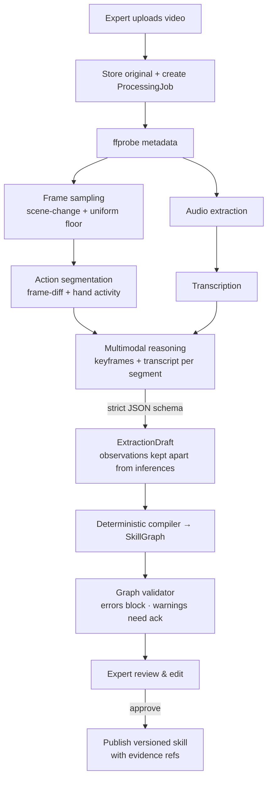
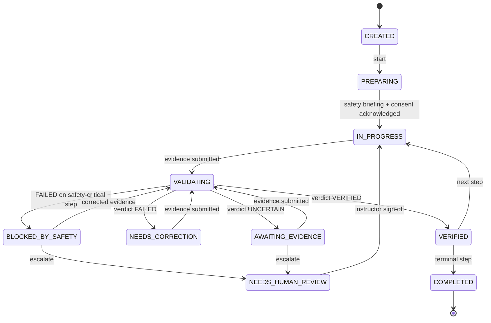

# SkillOS Architecture

## 1. Guiding principle

AI proposes, deterministic code decides.

- The **AI** (OpenAI) drafts skill graphs from demonstrations, describes what it sees in a frame, and explains steps.
- **Deterministic code** validates graphs, runs the session state machine, judges evidence (VERIFIED / UNCERTAIN / FAILED), and computes every score.
- No AI output can advance a session, skip a mandatory step, publish a skill, or change a score directly. AI output is *evidence input* to rules.

## 2. System overview

```mermaid
flowchart LR
  subgraph Clients
    W[React web app<br/>admin · expert · learner]
    A[Android app (Kotlin)<br/>camera-first sessions & capture]
  end
  subgraph Backend [FastAPI backend]
    API[REST /api/v1 + WebSocket]
    AUTH[Auth & RBAC<br/>org isolation]
    SK[Skill service<br/>versions · publish]
    SG[Skill graph engine<br/>schema · validator · NetworkX]
    VID[Video ingestion]
    EXT[Extraction pipeline]
    SES[Session orchestrator<br/>state machine]
    VAL[Evidence validator<br/>deterministic rules]
    ASM[Assessment & competency engine]
    AI[AI gateway<br/>OpenAI, strict schemas]
    CV[CV module<br/>OpenCV · YOLO · MediaPipe]
  end
  PG[(PostgreSQL)]
  RD[(Redis<br/>jobs · cache)]
  FS[(Object storage<br/>videos · frames)]
  OAI[[OpenAI API]]

  W & A --> API
  API --> AUTH & SK & VID & SES & ASM
  SK --> SG
  VID --> FS
  VID --> RD --> EXT
  EXT --> CV & AI
  EXT --> SG
  SES --> VAL
  VAL --> CV & AI
  SES --> ASM
  AI --> OAI
  SK & SES & ASM & VID --> PG
```

## 3. Repository structure

```
skillos/
├── backend/                 FastAPI service
│   ├── app/
│   │   ├── core/            config, db, security, deps, rate limit, audit
│   │   ├── models/          SQLAlchemy ORM (one file per domain)
│   │   ├── api/v1/          routers: auth, skills, videos, extraction, sessions, assessments
│   │   ├── skillgraph/      JSON schema (Pydantic), validator, NetworkX graph
│   │   ├── sessions/        state machine + orchestrator
│   │   ├── validation/      deterministic evidence evaluation
│   │   ├── assessment/      scoring + competency levels
│   │   ├── ai/              OpenAI gateway, extraction & observation prompts
│   │   ├── video/           FFmpeg frame/audio extraction, scene sampling
│   │   ├── cv/              detector interface (YOLO), frame-diff segmentation
│   │   └── seed/skills/     three solar MVP modules (JSON skill graphs)
│   └── tests/
├── frontend/                React + TypeScript + Tailwind (Vite)
├── android/                 Kotlin app (CameraX, Retrofit/OkHttp WebSocket)
├── docs/                    architecture, database, API, demo script
└── docker-compose.yml       postgres, redis, api, worker, web
```

## 4. Critical dependencies

| Area | Dependency | Why |
|---|---|---|
| API | FastAPI, Pydantic v2, Uvicorn | typed contracts, OpenAPI docs |
| Data | SQLAlchemy 2, PostgreSQL 16 (SQLite in tests) | relational core, JSON for graphs |
| Jobs | Redis + RQ | video processing off the request path |
| Graph | NetworkX | reachability, cycles, path analysis |
| Auth | PyJWT, argon2-cffi | tokens, password hashing |
| AI | `openai` SDK (Responses API, structured outputs, function calling) | extraction, observation, explanations |
| Video | FFmpeg / ffprobe | frames, audio, metadata |
| CV | OpenCV, Ultralytics YOLO, MediaPipe | detection, hands, frame differencing |

## 5. Video-to-skill pipeline



Every step in a generated graph carries `evidence_refs` (video id, time range, frames, transcript excerpt) and an extraction `confidence`. Steps below the confidence threshold are flagged for expert attention.

## 6. AI components

| Component | Input | Output | Can it change state? |
|---|---|---|---|
| Extraction agent | keyframes, transcript, segments | `ExtractionDraft` (strict schema) | No. Compiler + validator + expert gate it |
| Observation agent | frame(s), current step criteria | per-criterion `observed / contradicted / not_visible` + confidence | No. Validator turns it into a verdict |
| Instruction agent | approved step text, learner question | explanation grounded in the approved skill | No, read-only |
| Assessment narrative | computed scores | human-readable summary | No. Numbers come from the engine |

Tool calls from the model are limited to a small allow-list (`retrieve_current_step`, `request_additional_observation`, …). Arguments are validated with Pydantic. Every AI call is logged in `ai_call_logs`.

## 7. Session state machine



Any non-terminal state can move to `ABANDONED`.

## 8. Evidence verdict rules (deterministic)

- **Measurement** (e.g. multimeter DC voltage): in range → VERIFIED; outside → FAILED; missing → UNCERTAIN. Polarity uses the sign of the reading.
- **Visual**: each criterion needs `observed` at or above the confidence threshold for VERIFIED. Any `contradicted` at or above the threshold → FAILED. Anything else → UNCERTAIN.
- **Learner confirmation**: only accepted on steps whose policy lists it, and **never** as the sole evidence for a safety-critical step.
- **Instructor sign-off**: resolves `NEEDS_HUMAN_REVIEW`. It is recorded as instructor-verified, not camera-verified.

## 9. Implementation risks

| Risk | Mitigation |
|---|---|
| Generic YOLO weights don't know solar components | Detector is pluggable. Ship a fine-tune recipe. Until then, rely on the vision model with explicit `not_visible` |
| Vision models can't reliably read polarity from a photo | Safety-critical electrical steps require a measurement, not just a photo |
| LLM output drifts from schema | Strict JSON schema, Pydantic re-validation, deterministic compiler |
| Hallucinated steps | Evidence refs per step, confidence flags, mandatory expert approval |
| Cost/latency of video analysis | Scene-change sampling, per-segment keyframes, background jobs |
| Privacy of learner video | Consent per session, org-scoped access, retention policy, frames not stored unless opted in |

## 10. First demonstrable milestone (M1)

A seeded, expert-approved **Solar Lighting Installation** skill that a learner can run end to end through the API. A reversed-polarity measurement blocks the session. The corrected reading unblocks it. Completion produces an evidence-derived competency report. All of this is covered by automated tests.
